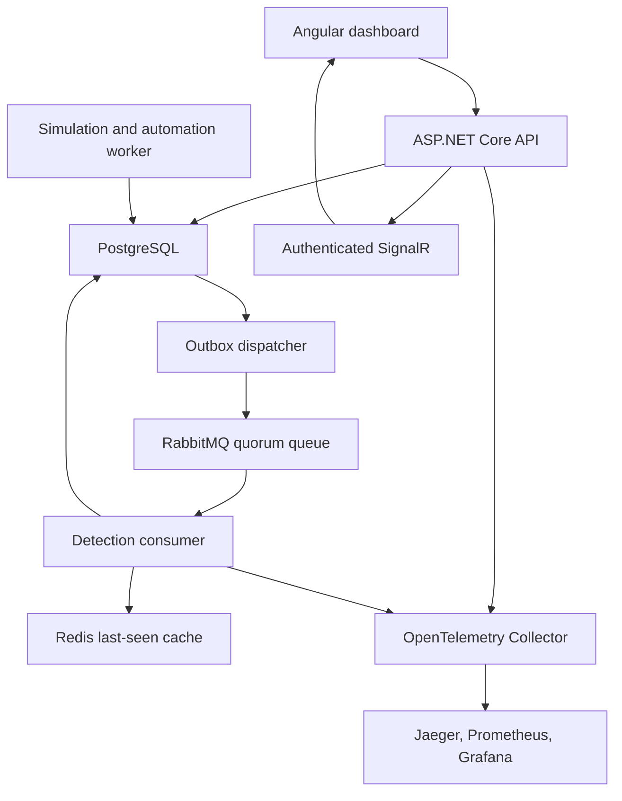

# Architecture
## Deployment topology

The API and worker are the two backend deployables. Domain modules have clear source boundaries without a network hop for every operation. The frontend reverse proxy provides a single browser origin for cookies, CSRF, REST and WebSockets.

## Reliable event lifecycle
1. Validate the complete batch before opening the ingestion transaction.
2. Acquire a PostgreSQL transaction advisory lock for idempotency checks; matching repeated IDs are acknowledged, changed payloads return 409.
3. Insert raw events and outbox rows in one commit. Ingestion succeeds even if RabbitMQ is unavailable.
4. Dispatch persisted IDs to a durable quorum queue. Await publisher confirmation before marking the outbox row published.
5. Process each delivery under a detection transaction lock. If its inbox record exists, acknowledge it without creating another alert.
6. Evaluate active rule versions against stored event-time evidence. Persist alerts, evidence, audit entries and the inbox record in one commit.
7. Acknowledge only after the database commit. A crash between commit and acknowledgement leads to harmless redelivery.

A crash between publish confirmation and outbox commit can publish twice. That is intentional at-least-once transport; consumer idempotency handles it. This is not a claim of exactly-once messaging.

The initial implementation serializes ingestion checks, outbox batches, and detection using separate advisory locks. It favors correctness and clear failure behavior over horizontal throughput. Performance measurements must precede any scale claim.

## Detection semantics
Thresholds group by device, account, synthetic flag and scenario run. Windows are inclusive and use event timestamps. Older arrivals cause later anchors in the applicable window to be reconsidered. Events more than seven days old or more than two minutes in the future are rejected.

Alert deduplication suppresses overlapping windows for the same rule version and entity context. This is a window suppression policy, not a full multi-stage threat graph. Current threshold evidence is captured at creation; additional correlated alerts can be attached to an incident.

Telemetry-loss detection currently targets the explicit synthetic lab scenario. A production collector heartbeat registry is outside the implemented integration set.

PostgreSQL is authoritative for detection windows. Redis's last-seen cache expires after a day and can be rebuilt. It cannot cause an event to be lost.

## State and concurrency
Mutable rules, alerts, incidents, assets, playbooks, scenario runs and response runs carry integer concurrency versions. The API checks client versions; EF also places the original version in the database update condition. A stale writer receives 409 and must reload.

Incident timeline and audit entries are append-only in SaveChanges and through PostgreSQL triggers. Database owners still control the database; this is not cryptographic tamper-proof storage.

## Response safety
Manual requests require a different approving operator. Automatic incident-created rules only create pending proposals; a human must approve execution. The requested playbook action and version are saved with each response run. Editing the playbook later cannot substitute another action into that request.

Execution checks approval and synthetic asset boundaries again. Device/account actions only change local flags. Notification adds a case timeline entry. Assignment updates case ownership; escalation updates case severity. All effects and execution records share a database transaction.

## Live updates and observability
The API polls aggregate counts every two seconds and broadcasts a change notification through authenticated SignalR. Clients refresh REST data periodically as well. This avoids introducing another fan-out queue before validating the first deployment. It is unsuitable for high-cardinality multi-tenant streaming without further design.

Ingestion stores the current trace parent in the outbox; dispatch creates a child activity, forwards traceparent in RabbitMQ headers, and detection continues that trace. Verify this path in Jaeger during integration acceptance. OTLP uses the optional monitoring profile; core application operation does not depend on telemetry export availability.

## Future extraction
Extract ingestion or detection when independently measured load justifies it. Preserve the event contract and inbox/outbox invariants. Add a gateway only when it provides concrete routing or policy value. Multi-tenancy, production EDR/IdP adapters, external notifications and managed deployment require additional design and authorization.

## Migration authoring
The initial table/index/foreign-key SQL is generated from the EF relational model. Append-only trigger SQL is appended to the initial migration resource. SocDbModelSnapshot is generated by EF tooling, and ModelChecks verifies column coverage and HasPendingModelChanges without opening a database connection. Execution against PostgreSQL remains a separate integration gate.
